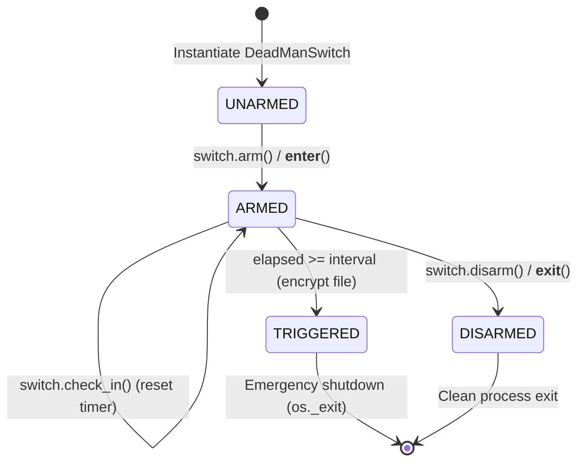

# Architecture Overview

CHECKMATE is designed with a local-first philosophy, prioritizing simplicity, auditability, and deterministic behavior.

## Core Components

1. **Switch Engine (`DeadManSwitch`)**:
   Maintains state (`is_armed`, `last_checkin`, `interval`, `key`). Provides `time_remaining` property calculation and acts as a context manager (`__enter__` / `__exit__`).

2. **Background Monitor Thread**:
   Monitors elapsed time without blocking terminal input or main loop execution using sub-second resolution polling against a `threading.Event` stop flag.

3. **Cryptographic Subsystem**:
   Uses authenticated symmetric encryption (`Fernet` AES-128-CBC with HMAC-SHA256) to secure target files upon trigger, preserving recovery keys for prototype testing.

4. **Interactive CLI & Command Loop (`run_cli`)**:
   Provides an interactive terminal interface parsing commands (`checkin`, `status`, `disarm`, `help`) with live countdown tracking and automated test file bootstrapping.

## Threading Model

- **Main Thread**: Handles user commands, terminal input (`input()`), signal interrupts (`KeyboardInterrupt`), and lifecycle control.
- **Daemon Monitor Thread**: Executes periodic time difference checks (`time.time() - last_checkin`) at 0.5-second resolution.
- **Exit Synchronization**: Uses `threading.Event` for clean shutdown and atomic triggers. Disarming automatically signals and joins the monitor thread.

## Switch Lifecycle State Machine

